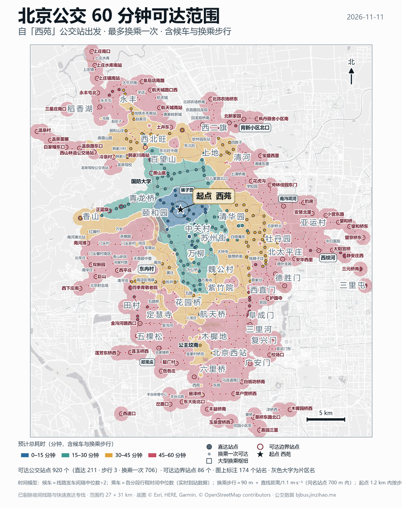

# bjbus-reach-map · 北京公交 60 分钟可达范围图

给任意一个北京公交站，算出「一小时、最多换乘一次」能到哪些站，并出图。



## 它回答什么问题

**「从 A 站出发，60 分钟内（含候车、换乘步行）能到哪些公交站？」**

- 起点线路 + 一次换乘，逐段用真实时刻表算时间
- 输出：总图（等时面 + 站点 + 片区名）、核心区放大图、站点明细 CSV、GeoJSON、Shapefile（WGS84）

## 安装

这是一个 **skill**：一个装着 `SKILL.md` 的文件夹，没有编译、没有依赖注入、不是插件包。
任何支持 Agent Skills 约定的 agent 都能直接用（Claude Code、Cursor、Codex 或自建 agent 都行）。

三种用法，任选其一：

1. **放进 skills 目录**——把整个文件夹拷到你的 agent 扫描 skills 的位置（各家路径不同，
   通常是 `~/.<agent>/skills/` 或项目下的 `.skills/`），保证 `SKILL.md` 在该文件夹根目录。
2. **当系统提示**——直接把 `SKILL.md` 的内容贴进系统提示或项目规则文件（如 `AGENTS.md`、`.cursorrules`）。
3. **纯手工**——`SKILL.md` 就是一份操作说明，人照着敲命令也行。

```bash
git clone https://github.com/KochiyaSrU/bjbus-reach-map.git
```

装好后 agent 看到的是：什么时候该用它、怎么一条命令出图、以及 13 类会踩的坑。
`reference/PROCESS.md` 是完整踩坑记录，改代码前值得读一遍。

## 一条命令

```bash
python make_map.py --origin "西苑" --out "D:\out\西苑60分钟可达" --shp xiyuan_60min
```

| 参数 | 默认 | 说明 |
|---|---|---|
| `--origin` | 必填 | 站名必须与数据完全一致（`四惠枢纽站`，不是 `四惠`） |
| `--out` | 必填 | 交付目录 |
| `--shp` | `reach60` | shapefile 名，保持 ASCII |
| `--core-km` | 4.6 | 核心区放大图半径（km） |
| `--wait-mode` | `average` | `average` / `best` / `worst` |
| `--work` | `work/<站名>` | 中间目录，可复用 |

## 时间模型

```
总耗时 = 候车₁ + 乘车₁ + 换乘步行 + 候车₂ + 乘车₂ ≤ 60 min
```

**候车分档**（按乘客实际乘车方式，不是一刀切）：

| 线路 | 候车 | 理由 |
|---|---|---|
| 发车间隔 < 20 min | 间隔 ÷ 2 | 车随到随走，没人看时刻表 |
| 发车间隔 ≥ 20 min | **0（卡点）** | 一天几班的定班车，乘客必然看时刻表去坐 |
| 高峰专线（10–15 点无车） | 整条剔除 | 中午根本没车，不能当全天可用 |
| 夜间线路（夜*） | 剔除 | 口径是白天出行 |

**发车间隔用带日期的 `query_schedules_by_route_id` 计算**：按服务日分组、
合并同一班车被重复记录的两次、取平均间隔。

> 为什么不能直接用 `query_route_timetable`：它没有日期列，多个服务日会混在一起
> （延庆 Y19 看着 4 班，其实是「2 班/天 × 2 天」），而且同一班车常被记两次
> （F23：05:15 与 05:28），会让间隔被压到一半以下。校验：F23 这样算出 90.2 min，
> 与官方时刻表 9 班、均值 88 min 吻合。

## 依赖

- Python 3、numpy、scipy、matplotlib、Pillow
- 能访问 `https://bjbus.jinzihao.me/sse`（bjbus MCP）
- 可选：ArcGIS 10.8 的 `C:\Python27\ArcGIS10.8\python.exe`，只用于生成 shapefile。
  **缺了会少 5 个文件但仍 exit 0**，交付前务必确认 9 个文件齐全。

## 数据与口径

- **数据源只有一个：bjbus MCP。** 不要用网页或第三方时刻表补数据，否则结果无法复现。
- 坐标：feed 是 GCJ-02，底图是 WGS84，`model.parse_route_info()` 已转换。
  自检：在 `work/<站名>` 里跑 `python qa_offset.py`，应输出 `dx=0 dy=0`。
- 同名站点 700 m 内视为可换乘；起点 1.2 km 内叠加步行。

## 自检

```bash
python scripts/selfcheck.py "<交付目录>"
```

核对 CSV / GeoJSON / DBF / SHP 的记录数是否一致。

## 已知限制

- 时间是实时到站滚动窗口的常态中位数，不含突发拥堵
- 只算公交 + 步行，**没有地铁**
- 等时面是站点时间的 IDW 插值，两站之间的色块是推断值
- 快速公交/高速快线会造成「跳跃式」可达，图上表现为孤立色斑，属真实情况
- 农村定班车班次极少，60 分钟预算基本被候车吃掉，图上往往只剩零散几个站
- 高峰专线被整条剔除；要算通勤场景需另行指定出行时刻

## 文档

- `SKILL.md` —— 给 AI agent 读的执行说明（流程、规则表、坑）
- `reference/PROCESS.md` —— 完整踩坑记录，改代码前必读

## 作者

**极地东风谷（KochiyaSrU）** — https://github.com/KochiyaSrU

数据来自 bjbus MCP（https://bjbus.jinzihao.me/sse），底图 © Esri, HERE, Garmin, OpenStreetMap contributors。

## License

MIT

